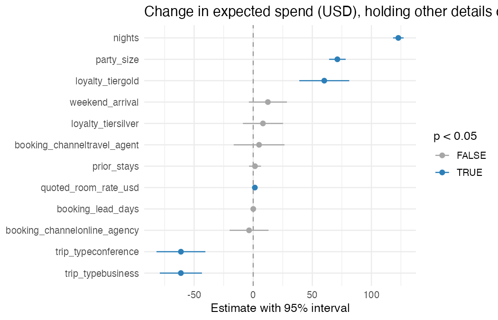
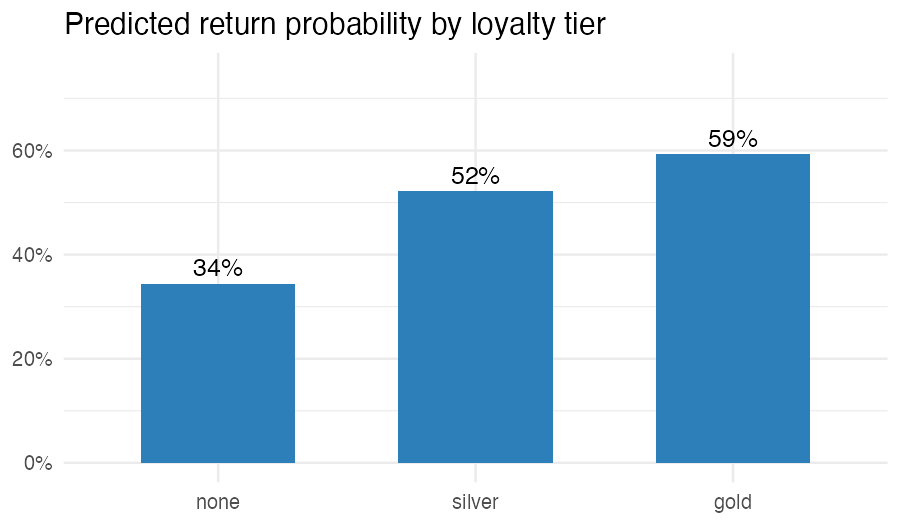
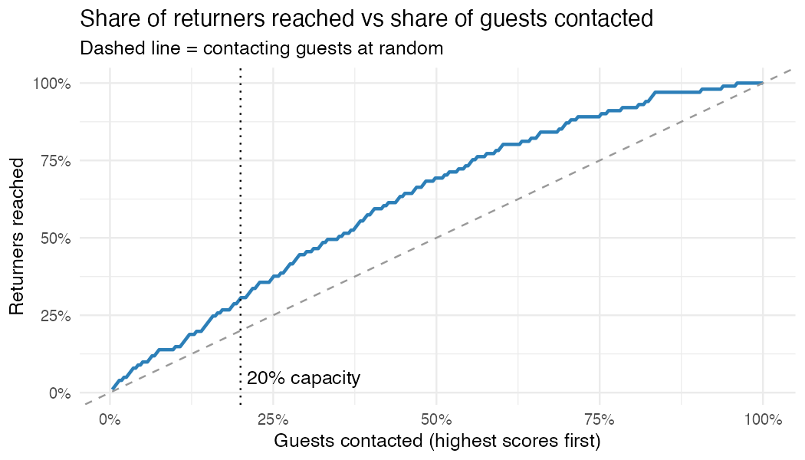

# Resort Booking Analytics

**Forecasting stay revenue and targeting likely return guests with regression in R**

A resort has one set of booking-time data and two teams with different questions:

- **Revenue:** what will this stay be worth in dollars?
- **Guest relations:** with capacity to contact only 20% of guests, whom should we follow up with?

This project builds a separate model for each question and shows why each one needs its own success metric.

## Results

| Question | Model | Result on unseen bookings |
|---|---|---|
| Stay revenue | Multiple linear regression | Typical miss **\$102**, vs \$207 for predicting the average |
| Return within a year | Logistic regression | Top-20% list: **55%** of contacted guests returned vs 36% overall (**1.5×** random) |

**Key findings**

- Each extra night adds about **\$123** to expected spend, and each extra guest about **\$71**.
- Gold members spend about **\$60 more** and are far more likely to return (**59%** vs 34% with no tier, for a typical booking).
- Each prior stay raises the odds of returning by about **29%**.
- The hit rate holds at about **55%** from 10% to 30% contact, so growing outreach to 30% would reach **46%** of returners (vs 31%) at no loss in precision.
- The return model ranks guests usefully (AUC ≈ 0.70) but shows likelihood, not the effect of outreach. Measuring that would need a randomized contact test.

## Charts

## Does outreach pay off?

A \$10 contact breaks even if it raises a guest's chance of returning by about **1 percentage point** (valuing a return at one average stay of about \$1,100). A randomized contact test would show whether outreach clears that bar.

## Approach

1. **Leakage control:** each model drops the other outcome, since neither is known when a booking arrives.
2. **Reproducible 80/20 split**, with the test set used once for final evaluation.
3. **Baselines:** the training average for spend; the average return rate for probabilities.
4. **Diagnostics:** residual, normality, multicollinearity (VIF), and influence (Cook's distance) checks.
5. **Decision framing:** contact rule compared at a fixed capacity, with a gains curve across 10–30%.

## Files

| File | Contents |
|---|---|
| `analysis.Rmd` | Full analysis and narrative |
| `analysis.html` | Rendered report (knit `analysis.Rmd`) |
| `data/resort_bookings.csv` | 1,400 simulated bookings |
| `data/resort_bookings_data_dictionary.md` | Field definitions |

## Run it

Open `analysis.Rmd` in RStudio from this folder and click **Knit**. Packages install automatically through `pacman`.

## Tools

R · tidyverse · caret · pROC · R Markdown

*Data are simulated bookings from a graduate business analytics course and do not represent real guests or resort performance.*
